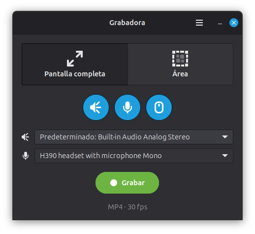

# Grabadora

Grabador de pantalla sencillo para Linux Mint (X11), al estilo de Kooha.
Graba la pantalla completa o un área, con audio del sistema y/o micrófono.



## Funciones

- **Pantalla completa o área**: en modo *Área* arrastras con el mouse el rectángulo a grabar (Esc o clic derecho cancela).
- **Audio del sistema** y **micrófono**, juntos o por separado (se mezclan en una sola pista).
- **Selección de dispositivos en la ventana principal**:
  - 🔊 *Audio del sistema*: la salida (altavoces, audífonos…) cuyo sonido se graba.
  - 🎤 *Micrófono*: la entrada que se graba.
  - La opción *Predeterminado* muestra el nombre real del dispositivo que se usará.
  - Si el dispositivo elegido se desconecta, se usa el predeterminado del sistema.
  - Las listas se actualizan al volver a la ventana (por si conectas otro dispositivo).
  - Cada lista se desactiva cuando su botón de audio está apagado.
- **Mostrar u ocultar el puntero**.
- **Pausar / continuar** y **detener y guardar**, con cronómetro.
- Notificación al guardar con botones *Abrir* y *Mostrar en carpeta*.

## Ajustes (menú ☰)

| Ajuste | Opciones |
|---|---|
| Formato | MP4 (H.264 + AAC), MKV (H.264 + Opus), WebM (VP8 + Opus) |
| Cuadros por segundo | 24, 30, 60 |
| Espera antes de grabar | Sin espera, 3, 5, 10 segundos |
| Guardar en | Carpeta de destino (por defecto `~/Videos`) |
| Minimizar al grabar | Oculta la ventana para que no salga en el video |

Los ajustes se guardan en `~/.config/grabadora/ajustes.json`.

## Requisitos

- Sesión **X11** (usa `ximagesrc`; no funciona en Wayland).
- Python 3 con PyGObject (GTK 3).
- GStreamer 1.0 con los plugins *good*, *bad*, *ugly* y *libav*.
- PulseAudio o PipeWire (con `pactl`).
- `notify-send` (libnotify) para las notificaciones.

En Linux Mint / Ubuntu:

```bash
sudo apt install python3-gi gir1.2-gtk-3.0 gir1.2-gstreamer-1.0 \
  gstreamer1.0-plugins-good gstreamer1.0-plugins-bad gstreamer1.0-plugins-ugly \
  gstreamer1.0-libav gstreamer1.0-pulseaudio pulseaudio-utils libnotify-bin
```

## Instalación

Para el usuario actual, sin sudo:

```bash
./instalar.sh
```

Instala el programa en `~/.local/share/grabadora`, el comando `grabadora` en `~/.local/bin` y el lanzador en el menú como **Grabadora**.

Desinstalar:

```bash
./instalar.sh --desinstalar
```

También se puede ejecutar sin instalar:

```bash
python3 grabadora.py
```

## Uso

```bash
grabadora            # abre la ventana
grabadora --toggle   # empieza o detiene una grabación
```

`--toggle` sirve para asignar un **atajo de teclado** (Configuración del sistema → Teclado → Atajos personalizados). Si hay una cuenta regresiva en curso, la cancela.

Las grabaciones se guardan como `Grabación_AAAA-MM-DD_HH-MM-SS.<ext>`.

## Cómo funciona

- El video se captura con GStreamer (`ximagesrc`) y se codifica según el formato elegido.
- El audio del sistema se graba desde el *monitor* de la salida elegida (`<salida>.monitor`) y el micrófono desde la entrada elegida, ambos con `pulsesrc`. Si se usan los dos, se mezclan con `audiomixer`.
- Los dispositivos se listan con `pactl -f json list sinks|sources`.
